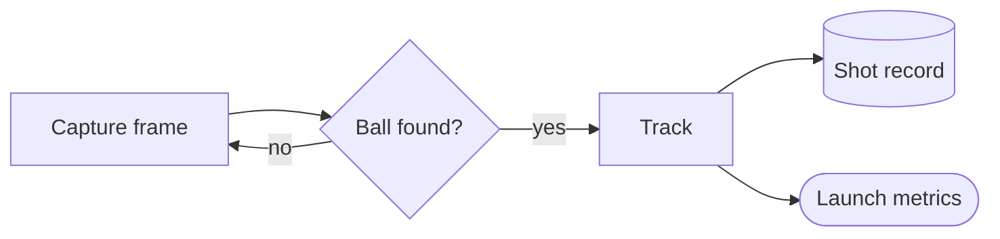
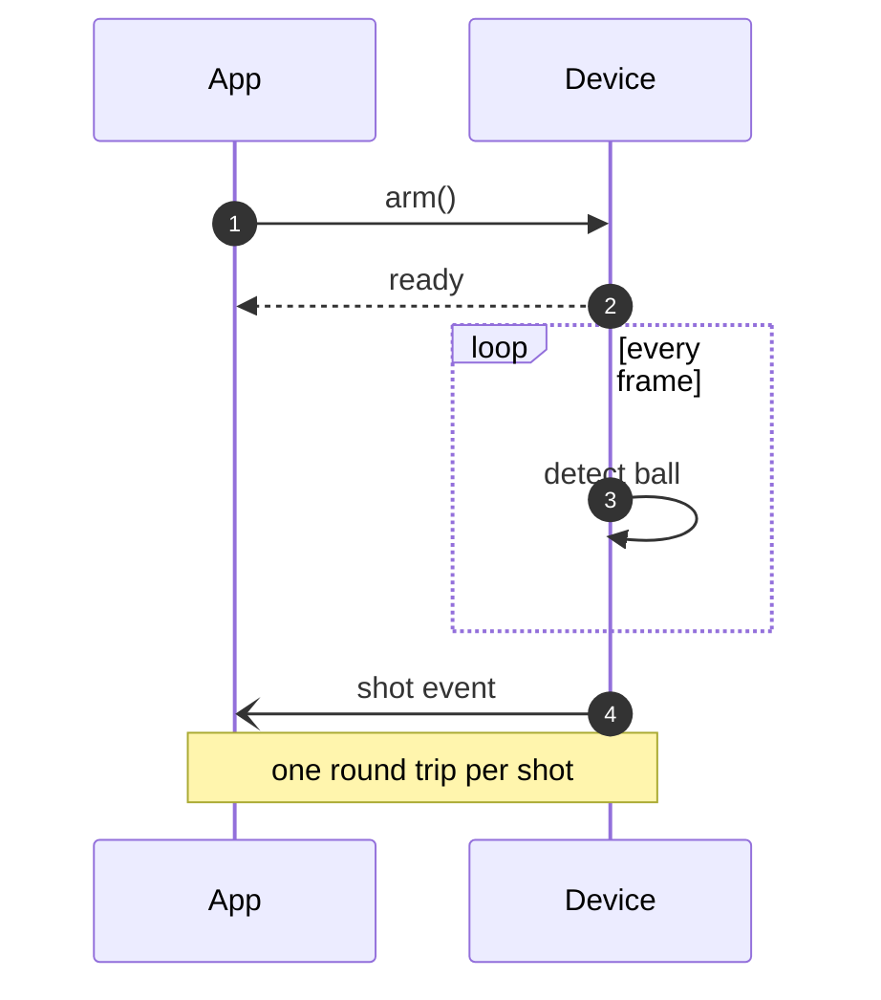
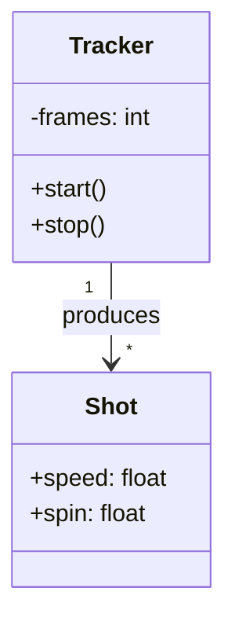
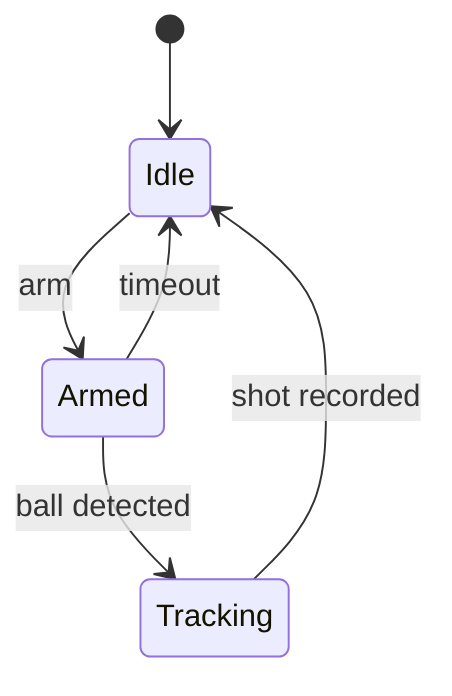
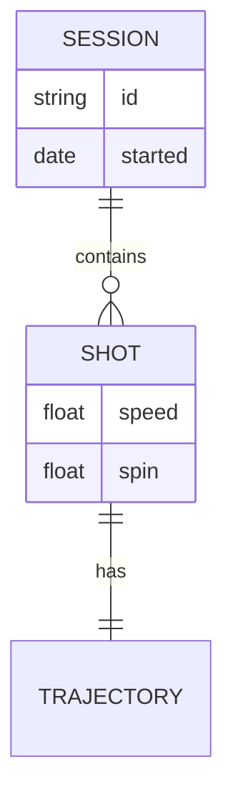
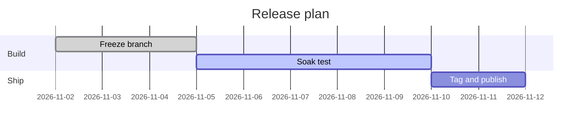
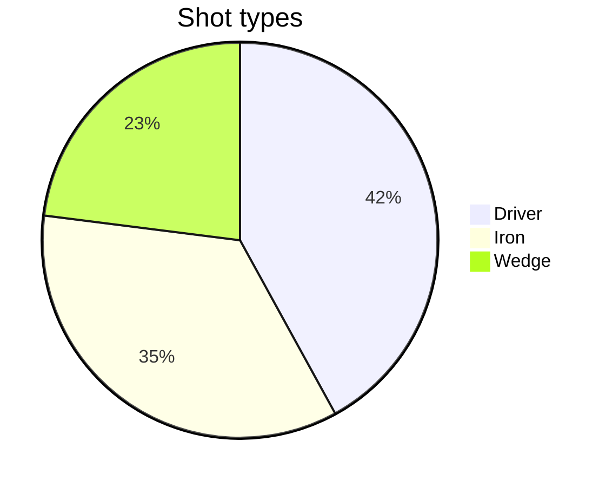
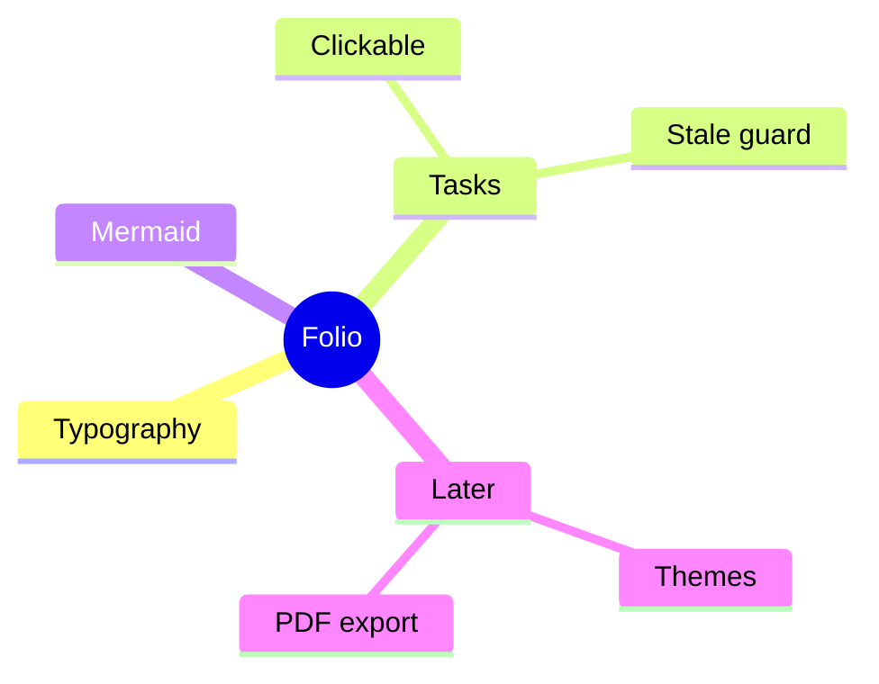
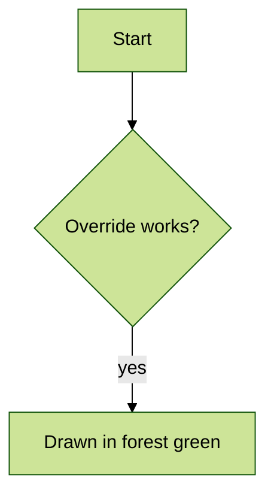

<!-- markdownlint-disable MD004 MD029 MD032 -->
<!-- The mixed bullet styles, list numbering and adjacent lists are deliberate test cases. -->

# Folio feature tour

Open this file and press `Ctrl+Shift+V`. Each section says what you should see. After clicking through the tasks, run `git checkout examples/feature-tour.md` to reset it.

**Contents panel.** A panel on the left lists the `#`, `##` and `###` headings of this file, so the Mermaid diagram names appear under section 4. Clicking an entry scrolls to that heading; the button at the panel's top collapses it and opens it again, and it stays as you left it while you edit. Drag the panel's right edge to resize it; double-click the edge to reset it. Set `folio.toc.levels` to `2` and the diagram names disappear.

## 1. Clickable tasks

The first click on any checkbox asks *"Allow 'Folio — Markdown Preview' extension to open this URI?"*. Tick **Do not ask me again for this extension** and choose **Open**.

**Expect:** each click flips `[ ]` ↔ `[x]` on that exact line in the source and saves the file; the preview redraws with the new state.

- [ ] Plain bullet task
- [x] Already done (lowercase `x`)
- [X] Already done (uppercase `X`); unchecking writes a space
- [ ] Task with **bold**, `code` and [an example link](https://example.com) in it; the link still opens normally
* [ ] Star bullet
+ [ ] Plus bullet

1. [ ] Ordered task
2. [x] Ordered task, done
3) [ ] Ordered with a parenthesis

- [ ] Parent task
  - [ ] Nested child
  - [x] Nested child, done
    - [ ] Grandchild
- [ ] Task whose text
  wraps onto a second source line; clicking still edits the first line

> - [ ] Task inside a blockquote
> - [x] Another one, done

- Mixed list: this item is not a task
- [ ] but this one is

## 2. Things that must not become checkboxes

**Expect:** no checkbox anywhere in this section.

- [ ]no space after the brackets
- [y] wrong letter
- plain text with [ ] brackets in the middle
- [link text](https://example.com) at the start of an item

[ ] Brackets outside a list

```markdown
- [ ] a task inside a code block stays literal text
```

## 3. Stale-preview guard

**Expect:** double-click the checkbox below quickly. The first click checks it. The second arrives before the preview has redrawn, so it still claims the box was unchecked; Folio sees the source now says `[x]`, shows *"the preview is out of date…"*, and leaves the file checked rather than flipping it back.

- [ ] Stale-guard target

## 4. Mermaid diagrams

**Expect:** each diagram drawn at its natural size, centred, on white, with no frame, scroll box or zoom controls. Typing in a diagram updates it without the other diagrams flickering.

### Flowchart



### Sequence



### Class



### State



### Entity relationship



### Gantt



### Pie



### Mindmap



### Per-diagram theme override

**Expect:** this one alone uses the `forest` theme (green), whatever `folio.mermaid.theme` is set to.



### Broken diagram

**Expect:** a red error from Mermaid naming the problem, with the diagram's source under it, and the rest of the page unaffected.

```mermaid
flowchart LR
    A -->
```

### Built-in `:::mermaid` syntax (not Folio)

**Expect:** VS Code's own Mermaid support draws this one, in its pan/zoom box. It is here to show the difference, not as a Folio feature.

:::mermaid
flowchart LR
    Builtin --> PanZoomBox
:::

## 5. Typography

**Expect:** a readable column with generous line height, headings closer to the text below them than above, ligatures in code, and digits that line up in the table.

Body text should be comfortable at length. This paragraph is long on purpose so the measure, the line height and the wrapping can be judged on a real block of prose rather than a single line, which tells you very little about how a document will read once it has several screens of explanation in it.

> A blockquote keeps a thin rule on the left and indents its text.

Inline `code => ligatures != plain` and a block:

```cpp
auto fps = frames / elapsed.count();   // => tabular digits below
if (fps >= 240 && fps != 0) { log("ok"); }
```

| Club   | Speed (mph) | Spin (rpm) | Carry (yd) |
| ------ | ----------: | ---------: | ---------: |
| Driver |       167.4 |       2611 |      281.0 |
| 7-iron |       120.1 |       7097 |      172.5 |
| Wedge  |        98.6 |       9304 |      111.1 |

A table written with an empty header row has no header: only the heavy rules above and below its rows, no light rule under an empty first row.

|       |                                    |
| ----- | ---------------------------------- |
| Carry | Distance the ball flies in the air |
| Total | Carry plus roll                    |

### A third-level heading

Followed by a short paragraph.
